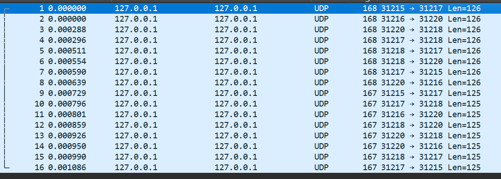
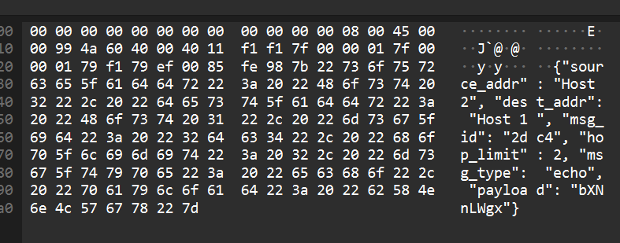

Do not really know how to fit this into 2 pages.

# Repository

The repository is available at [https://github.com/jake-bounds/mini-internet](https://github.com/jake-bounds/mini-internet). The commit for submission is 111ffbb3fcfa30a132610fa52f07a1cf9c9dde01, or 'More readme'

# Architecture

## Configuration

Topology is defined in toml files inside the topology directory. They specify hosts and their router address, and routers and their next hop tables. They specify UDP ports on the host machine for both. Network conditions are defined in the conditions directory. They specify link delay and loss on a source $\rightarrow$ destination ess basis. Then a config python file reads the config, throws validation errors, and makes the config available to host and router programs.

## Packets

Packets store what is defined in the assignment pdf; namely, source address, destination address, message type (probe, echo), message id, payload. During transmission, packets are converted from a dataclass to bytes by storing the payload as a base64 string, then JSON encoding the dataclass, then UTF-8 encoding the JSON string as bytes. They are converted back into dataclasses by the reverse process.

## Hosts

Hosts use asyncio.create_datagram_endpoint to allow for async processing of both user input to send probes to destination hosts and to accept packets from the router. Sent out probes the host is waiting on is stored in a dictionary keyed by the msg_id, along with an asyncio timer for timeout.

## Router

Routers do not use asyncio, though later I will probably make them do so. For now they just keep a socket in the main thread, receive incoming packets and forward them to the next hop based on the configuration. They perform validation to determine whether to drop packets. Link delay is achieved with threading.Timer.

## Defects

No defects to my knowledge. One thing I would like to do is create an actual link class for separation of concerns purposes. Maybe I could do struct packing instead of JSON for packets also.

# Schedule, Extension, Experimental Plan

I will do reliable transfer. Probably implementation for the next 2 weeks, then acceptance criteria and required evidence the next week, then presentation stuff the next week. 

# Acceptance Tests

In the repo, you would first need to create a virtual environment. I used Python 3.14. You also need bash and to be on Linux as one test requires sending raw bytes to a UNIX udp socket file.

The core acceptance scenarios can all be performed by bash scripts inside of the acceptance_scenarios directory. These work by running the router and host processes, then feeding input into either Host 1 or Host 2 or both and then either counting logs or printing them.

## Multihop

```bash
jake:~/mini-internet$ bash acceptance_scenarios/multihop.bash 

Run Id: nXgtHD
Topology: topology/upper.toml  Conditions: conditions/none.toml  Seed: 1
Logs: logs/multihop

Host 1: 20/20 matching responses, 0 bad payloads, 0 timeouts, 20 probes echoed
Host 2: 20/20 matching responses, 0 bad payloads, 0 timeouts, 20 probes echoed
```

## Configurable Paths

### Upper Path

```bash
jake:~/mini-internet$ bash acceptance_scenarios/configurable_paths.bash 

Run Id: UK5DlH
Topology: topology/upper.toml Conditions: conditions/none.toml  Seed: 1
Logs: logs/configurable_paths

== Router A
Using seed 1:Router A
UK5DlH | Router A | 1792634383.137582 | 1cf2 | probe | Host 1 | Host 2 | Router B | 5 | receive
UK5DlH | Router A | 1792634383.1376145 | 1cf2 | probe | Host 1 | Host 2 | Router B | 4 | forward
UK5DlH | Router A | 1792634383.1379075 | 8904 | probe | Host 2 | Host 1 | Host 1 | 3 | receive
UK5DlH | Router A | 1792634383.1379192 | 8904 | probe | Host 2 | Host 1 | Host 1 | 2 | forward
UK5DlH | Router A | 1792634383.1380932 | 8904 | echo | Host 1 | Host 2 | Router B | 5 | receive
UK5DlH | Router A | 1792634383.1381013 | 8904 | echo | Host 1 | Host 2 | Router B | 4 | forward
UK5DlH | Router A | 1792634383.1381273 | 1cf2 | echo | Host 2 | Host 1 | Host 1 | 3 | receive
UK5DlH | Router A | 1792634383.1381316 | 1cf2 | echo | Host 2 | Host 1 | Host 1 | 2 | forward

== Router B
Using seed 1:Router B
UK5DlH | Router B | 1792634383.137748 | 1cf2 | probe | Host 1 | Host 2 | Router D | 4 | receive
UK5DlH | Router B | 1792634383.1377804 | 1cf2 | probe | Host 1 | Host 2 | Router D | 3 | forward
UK5DlH | Router B | 1792634383.1378334 | 8904 | probe | Host 2 | Host 1 | Router A | 4 | receive
UK5DlH | Router B | 1792634383.1378539 | 8904 | probe | Host 2 | Host 1 | Router A | 3 | forward
UK5DlH | Router B | 1792634383.1380901 | 1cf2 | echo | Host 2 | Host 1 | Router A | 4 | receive
UK5DlH | Router B | 1792634383.138098 | 1cf2 | echo | Host 2 | Host 1 | Router A | 3 | forward
UK5DlH | Router B | 1792634383.1384206 | 8904 | echo | Host 1 | Host 2 | Router D | 4 | receive
UK5DlH | Router B | 1792634383.1384351 | 8904 | echo | Host 1 | Host 2 | Router D | 3 | forward

== Router C
Using seed 1:Router C

== Router D
Using seed 1:Router D
UK5DlH | Router D | 1792634383.1375713 | 8904 | probe | Host 2 | Host 1 | Router B | 5 | receive
UK5DlH | Router D | 1792634383.1376143 | 8904 | probe | Host 2 | Host 1 | Router B | 4 | forward
UK5DlH | Router D | 1792634383.1378536 | 1cf2 | probe | Host 1 | Host 2 | Host 2 | 3 | receive
UK5DlH | Router D | 1792634383.1378636 | 1cf2 | probe | Host 1 | Host 2 | Host 2 | 2 | forward
UK5DlH | Router D | 1792634383.1380403 | 1cf2 | echo | Host 2 | Host 1 | Router B | 5 | receive
UK5DlH | Router D | 1792634383.138045 | 1cf2 | echo | Host 2 | Host 1 | Router B | 4 | forward
UK5DlH | Router D | 1792634383.1384974 | 8904 | echo | Host 1 | Host 2 | Host 2 | 3 | receive
UK5DlH | Router D | 1792634383.138506 | 8904 | echo | Host 1 | Host 2 | Host 2 | 2 | forward
```

### Lower Path

```bash
jake@cerberus:~/mini-internet$ bash acceptance_scenarios/configurable_paths.bash lower

Run Id: TREZrs
Topology: topology/lower.toml Conditions: conditions/none.toml  Seed: 1
Logs: logs/configurable_paths

== Router A
Using seed 1:Router A
TREZrs | Router A | 1792634446.8607237 | a7c9 | probe | Host 1 | Host 2 | Router C | 5 | receive
TREZrs | Router A | 1792634446.8607593 | a7c9 | probe | Host 1 | Host 2 | Router C | 4 | forward
TREZrs | Router A | 1792634446.8615968 | a7c9 | echo | Host 2 | Host 1 | Host 1 | 3 | receive
TREZrs | Router A | 1792634446.8616233 | a7c9 | echo | Host 2 | Host 1 | Host 1 | 2 | forward
TREZrs | Router A | 1792634446.8626266 | 5bcc | probe | Host 2 | Host 1 | Host 1 | 3 | receive
TREZrs | Router A | 1792634446.8626366 | 5bcc | probe | Host 2 | Host 1 | Host 1 | 2 | forward
TREZrs | Router A | 1792634446.8627634 | 5bcc | echo | Host 1 | Host 2 | Router C | 5 | receive
TREZrs | Router A | 1792634446.8627772 | 5bcc | echo | Host 1 | Host 2 | Router C | 4 | forward

== Router B
Using seed 1:Router B

== Router C
Using seed 1:Router C
TREZrs | Router C | 1792634446.8608978 | a7c9 | probe | Host 1 | Host 2 | Router D | 4 | receive
TREZrs | Router C | 1792634446.8609219 | a7c9 | probe | Host 1 | Host 2 | Router D | 3 | forward
TREZrs | Router C | 1792634446.8614905 | a7c9 | echo | Host 2 | Host 1 | Router A | 4 | receive
TREZrs | Router C | 1792634446.8615203 | a7c9 | echo | Host 2 | Host 1 | Router A | 3 | forward
TREZrs | Router C | 1792634446.8625684 | 5bcc | probe | Host 2 | Host 1 | Router A | 4 | receive
TREZrs | Router C | 1792634446.8625786 | 5bcc | probe | Host 2 | Host 1 | Router A | 3 | forward
TREZrs | Router C | 1792634446.862889 | 5bcc | echo | Host 1 | Host 2 | Router D | 4 | receive
TREZrs | Router C | 1792634446.8629048 | 5bcc | echo | Host 1 | Host 2 | Router D | 3 | forward

== Router D
Using seed 1:Router D
TREZrs | Router D | 1792634446.8610532 | a7c9 | probe | Host 1 | Host 2 | Host 2 | 3 | receive
TREZrs | Router D | 1792634446.8610854 | a7c9 | probe | Host 1 | Host 2 | Host 2 | 2 | forward
TREZrs | Router D | 1792634446.8613598 | a7c9 | echo | Host 2 | Host 1 | Router C | 5 | receive
TREZrs | Router D | 1792634446.8613694 | a7c9 | echo | Host 2 | Host 1 | Router C | 4 | forward
TREZrs | Router D | 1792634446.8624923 | 5bcc | probe | Host 2 | Host 1 | Router C | 5 | receive
TREZrs | Router D | 1792634446.862509 | 5bcc | probe | Host 2 | Host 1 | Router C | 4 | forward
TREZrs | Router D | 1792634446.8629537 | 5bcc | echo | Host 1 | Host 2 | Host 2 | 3 | receive
TREZrs | Router D | 1792634446.8629627 | 5bcc | echo | Host 1 | Host 2 | Host 2 | 2 | forward
```

We can see that C has no logs in upper, and B has no logs in lower.

## Hop Limit

```bash
jake@cerberus:~/mini-internet$ bash acceptance_scenarios/hop_limit.bash 

Run Id: zOeasw
Topology: topology/loop.toml Conditions: conditions/none.toml  Seed: 1
Logs: logs/hop_limit

== Router A
Using seed 1:Router A
zOeasw | Router A | 1792634537.5530741 | 65f8 | probe | Host 1 | Host 2 | Router C | 5 | receive
zOeasw | Router A | 1792634537.553109 | 65f8 | probe | Host 1 | Host 2 | Router C | 4 | forward
zOeasw | Router A | 1792634537.553397 | 65f8 | probe | Host 1 | Host 2 | Router C | 3 | receive
zOeasw | Router A | 1792634537.5534158 | 65f8 | probe | Host 1 | Host 2 | Router C | 2 | forward
zOeasw | Router A | 1792634537.5535743 | 65f8 | probe | Host 1 | Host 2 | Router C | 1 | receive
zOeasw | Router A | 1792634537.5535939 | 65f8 | probe | Host 1 | Host 2 | Router C | 0 | drop (hop limit)

== Router C
Using seed 1:Router C
zOeasw | Router C | 1792634537.5532734 | 65f8 | probe | Host 1 | Host 2 | Router A | 4 | receive
zOeasw | Router C | 1792634537.5533 | 65f8 | probe | Host 1 | Host 2 | Router A | 3 | forward
zOeasw | Router C | 1792634537.5534902 | 65f8 | probe | Host 1 | Host 2 | Router A | 2 | receive
zOeasw | Router C | 1792634537.553504 | 65f8 | probe | Host 1 | Host 2 | Router A | 1 | forward
```

## Error Handling

First we send a packet of garbage bytes (not done inside of the host program as we must echo write directly to a socket file), then a packet with a nonexistent destination address, then a packet that is too large.

```bash
jake@cerberus:~/mini-internet$ bash acceptance_scenarios/error_handling.bash 

Run Id: d3R4ev
Topology: topology/loop.toml Conditions: conditions/none.toml  Seed: 1
Logs: logs/error_handling

== Host 1
Using seed 1:Host 1
To send a probe, type <dest_addr>:<msg> and press enter.
Sending probe f444 to Host 3.
Sending probe c037 to Host 2.
No response received for probe f444 in 5 seconds.
No response received for probe c037 in 5 seconds.

== Router A
Using seed 1:Router A
d3R4ev | Router A | 1792634703.5558481 | receive,drop (failed to decode)
d3R4ev | Router A | 1792634703.6025295 | f444 | probe | Host 1 | Host 3 | null | 5 | drop (no known next hop)
d3R4ev | Router A | 1792634703.6027217 | receive,drop (too large)
```

## Loss and Delay

```bash
jake@cerberus:~/mini-internet$ bash acceptance_scenarios/loss_and_delay.bash 

Run Id: QoZF2V  Seed: 1

=== forced_drop  Topology: topology/upper.toml  Conditions: conditions/forced_loss.toml
-- Router A
QoZF2V | Router A | 1792634745.907182 | 1120 | probe | Host 1 | Host 2 | Router B | 5 | receive
QoZF2V | Router A | 1792634745.907229 | 1120 | probe | Host 1 | Host 2 | Router B | 4 | drop (injected loss)
-- Host 1
Sending probe 1120 to Host 2.
No response received for probe 1120 in 5 seconds.

=== random_loss  Topology: topology/upper.toml  Conditions: conditions/loss.toml
Host 1: 12/20 responses, 8 timeouts. Router A: 8 drops

=== delay  Topology: topology/upper.toml  Conditions: conditions/delay.toml
-- Host 1
Sending probe 7873 to Host 2.
Sending probe 6882 to Host 2.
Sending probe 82c7 to Host 2.
Response received for probe 7873 in 0.5015176900051301 seconds.
Response received for probe 6882 in 0.5012876079999842 seconds.
Response received for probe 82c7 in 0.5011903090053238 seconds.

=== late_response  Topology: topology/lower.toml  Conditions: conditions/delay.toml
-- Router C
QoZF2V | Router C | 1792634775.9569743 | eb13 | probe | Host 1 | Host 2 | Router D | 4 | receive
QoZF2V | Router C | 1792634775.9570127 | eb13 | probe | Host 1 | Host 2 | Router D | 3 | forward
QoZF2V | Router C | 1792634775.9575913 | eb13 | echo | Host 2 | Host 1 | Router A | 4 | receive
QoZF2V | Router C | 1792634775.9576132 | eb13 | echo | Host 2 | Host 1 | Router A | 3 | forward
-- Host 1
Sending probe eb13 to Host 2.
No response received for probe eb13 in 5 seconds.
Received echo for a probe that wasn't sent by us (eb13).
```

# Baseline Measurements

```bash
jake@cerberus:~/mini-internet$ bash measurements/baseline.bash

Run Id: nZ3u4Q
Topology: topology/upper.toml  Probes: 20  Interval: 0.2s  Timeout: 5s
delay0_loss0 seed 1
delay0_loss0 seed 2
delay0_loss0 seed 3
delay0_loss05 seed 1
delay0_loss05 seed 2
delay0_loss05 seed 3
delay100_loss0 seed 1
delay100_loss0 seed 2
delay100_loss0 seed 3
delay100_loss05 seed 1
delay100_loss05 seed 2
delay100_loss05 seed 3

condition                  success %           mean RTT ms        timeouts
delay0_loss0             100.0 ± 0.0           1.10 ± 0.00       0.0 ± 0.0
delay0_loss05             90.0 ± 8.7           1.13 ± 0.06       2.0 ± 1.7
delay100_loss0           100.0 ± 0.0         202.07 ± 0.06       0.0 ± 0.0
delay100_loss05           90.0 ± 8.7         202.03 ± 0.06       2.0 ± 1.7
```

# Wireshark



Packets 1, 4, 6, 8 show Host 1's probe to Host 2.

Packets 11, 13, 15, 16 show the echo being sent back to Host 1.

They correspond to these logs:

```
Sending probe 2dc4 to Host 2.
pnoZns | Router A | 1792635869.3438892 | 2dc4 | probe | Host 1 | Host 2 | Router B | 5 | receive
pnoZns | Router A | 1792635869.3439243 | 2dc4 | probe | Host 1 | Host 2 | Router B | 4 | forward
pnoZns | Router B | 1792635869.3441973 | 2dc4 | probe | Host 1 | Host 2 | Router D | 4 | receive
pnoZns | Router B | 1792635869.3442056 | 2dc4 | probe | Host 1 | Host 2 | Router D | 3 | forward
pnoZns | Router D | 1792635869.3442655 | 2dc4 | probe | Host 1 | Host 2 | Host 2 | 3 | receive
pnoZns | Router D | 1792635869.3442836 | 2dc4 | probe | Host 1 | Host 2 | Host 2 | 2 | forward
p
Received probe 2dc4. Echoing.
pnoZns | Router D | 1792635869.3445647 | 2dc4 | echo | Host 2 | Host 1 | Router B | 5 | receive
pnoZns | Router D | 1792635869.3445747 | 2dc4 | echo | Host 2 | Host 1 | Router B | 4 | forward
pnoZns | Router B | 1792635869.3446293 | 2dc4 | echo | Host 2 | Host 1 | Router A | 4 | receive
pnoZns | Router B | 1792635869.3446405 | 2dc4 | echo | Host 2 | Host 1 | Router A | 3 | forward
pnoZns | Router A | 1792635869.3447278 | 2dc4 | echo | Host 2 | Host 1 | Host 1 | 3 | receive
pnoZns | Router A | 1792635869.3447375 | 2dc4 | echo | Host 2 | Host 1 | Host 1 | 2 | forward
Response received for probe 2dc4 in 0.0012912569945910946 seconds.
```

Since my virtual protocol is JSON, it is easy to inspect the packets. 



This is port 31217 to 31215, or Router A to Host 1. Its source address is Host 2, and destination is Host 1. This is the echo sent from Host 2 to Host 1 in response to Host 1's probe.

# Contributions

I am working alone so I have done everything